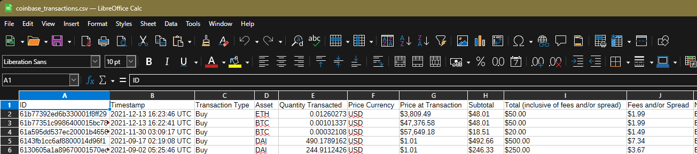

# Crypto Totals

Crypto Totals is a small Python CLI that summarizes cryptocurrency purchases and Gemini staking rewards from exported transaction-history CSV files. It prints an aggregate for each configured asset, including BTC and ETH by default.

> This project processes exported CSV files locally. It does not currently fetch account data from exchange APIs.

## Preview



## What it does

- Reads Gemini transaction and staking-history exports.
- Includes Gemini **Buy** transactions and **Interest Credit** staking records.
- Combines purchase and staking quantities into an aggregate for each configured asset.
- Reports the covered date range, quantity, subtotal, fees, total, and estimated spot price.

The Coinbase CSV parser is present in the script, but Coinbase aggregation is currently disabled in the main CLI run.

## Quick start

### Requirements

- Python 3.9 or newer
- pandas

Install pandas if needed:

```bash
python -m pip install pandas
```

### Run

Place the exported CSV files in the project directory, then run:

```bash
python aggregate_crypto.py
```

Run the command from the project directory so the script can find its input files. The script prints one summary for each asset in `TOKENS_TO_AGGREGATE` near the top of [`aggregate_crypto.py`](./aggregate_crypto.py).

## Input files

| File | Used for |
| --- | --- |
| [`gemini_transaction_history.csv`](./gemini_transaction_history.csv) | Gemini purchases |
| [`gemini_staking_transaction_history.csv`](./gemini_staking_transaction_history.csv) | Gemini staking interest credits |
| [`coinbase_transactions.csv`](./coinbase_transactions.csv) | Coinbase purchases; not included in the default run |

Use the CSV export format expected by the script. Exports with changed column names or formatting may need code updates.

## Notes

- This is a simple historical summary, not tax, accounting, or investment advice.
- The default run is limited to Gemini purchase and staking records for BTC and ETH.
- There is no as-of-date filter; the summary covers matching records in the input files.
- Review and sanitize exported financial data before sharing it or committing it to a public repository.

## Export transaction history

- [Gemini transaction history](https://exchange.gemini.com/settings/documents/transaction-history)
- [Coinbase statements](https://accounts.coinbase.com/statements)
